  <strong>力と設計のために</strong> &middot; <em>For the sake of power and clean architecture.</em>

  Backend Developer &amp; Systems Engineering Student based in Lima, Perú 🇵🇪. 
  Crafting high-concurrency APIs, local-first applications, and intelligent automation systems.

&nbsp;
&nbsp;

## `$ fastfetch --profile dossier` &middot; 電脳調書

  

## `$ cat /etc/ryoku/tech-stack.yaml` &middot; 技術構成

<table>
  <thead>
    <tr>
      <th colspan="2" align="left">
        <code>zsnow@arch:~$ cat /etc/ryoku/tech-stack.yaml &nbsp;·&nbsp; status: 稼働中</code>
      </th>
    </tr>
  </thead>
  <tbody>
    <tr>
      <td width="50%" valign="top">
        <code>├─ ⚙ backend_systems:</code>  
        
      </td>
      <td width="50%" valign="top">
        <code>├─ 🖥️ desktop_localfirst:</code>  
        
      </td>
    </tr>
    <tr>
      <td valign="top">
        <code>├─ ▣ databases_cache:</code>  
        
      </td>
      <td valign="top">
        <code>╰─ ☁ infrastructure_ops:</code>  
        
      </td>
    </tr>
  </tbody>
  <tfoot>
    <tr>
      <td colspan="2">
        <code>env: production&nbsp;&nbsp;·&nbsp;&nbsp;runtime: archlinux-zen&nbsp;&nbsp;·&nbsp;&nbsp;zen: 力と美のために</code>
      </td>
    </tr>
  </tfoot>
</table>

## `$ cat /var/projects/dossier.md` &middot; 主要プロジェクト

<table>
  <thead>
    <tr>
      <th colspan="2" align="left"><code>zsnow:~$ list-projects --status featured &nbsp;·&nbsp; 選抜プロジェクト</code></th>
    </tr>
  </thead>
  <tbody>
    <tr>
      <td width="50%" valign="top">
        <h3>🚀 <a href="https://aether.zsnow.dev">Aether OS</a> &middot; <code>個人システム</code></h3>
        
Sistema personal <strong>Local-First</strong> para operaciones, finanzas e infraestructura; disponible como aplicación web y de escritorio.

          
        🌐 <a href="https://aether.zsnow.dev"><strong>aether.zsnow.dev</strong></a>
      </td>
      <td width="50%" valign="top">
        <h3>📱 <a href="https://github.com/zSnowww/AetherRelay">Aether Relay</a> &middot; <code>画面ミラー</code></h3>
        
Aplicación de escritorio multiplataforma para reflejar pantalla de Android con baja latencia y control físico de teclado y ratón.

          
        📦 <a href="https://github.com/zSnowww/AetherRelay"><strong>GitHub Repo</strong></a> &middot; <a href="https://github.com/zSnowww/AetherRelay/releases"><strong>Releases</strong></a>
      </td>
    </tr>
  </tbody>
  <tfoot>
    <tr>
      <td colspan="2"><code>ポートフォリオ詳細: <a href="https://zsnow.dev/#proyectos">https://zsnow.dev/#proyectos</a></code></td>
    </tr>
  </tfoot>
</table>

## `$ github-activity --stats` &middot; 開発統計

  

  

## `$ spotify --top --range 4w` &middot; 音楽

  
  

力と美のために &middot; Crafted with discipline, code &amp; paper-ink aesthetics by Manu (zSnow) &middot; @zSnowww 
Cards by <a href="https://fluxstats-beta.vercel.app">FluxStats</a>

